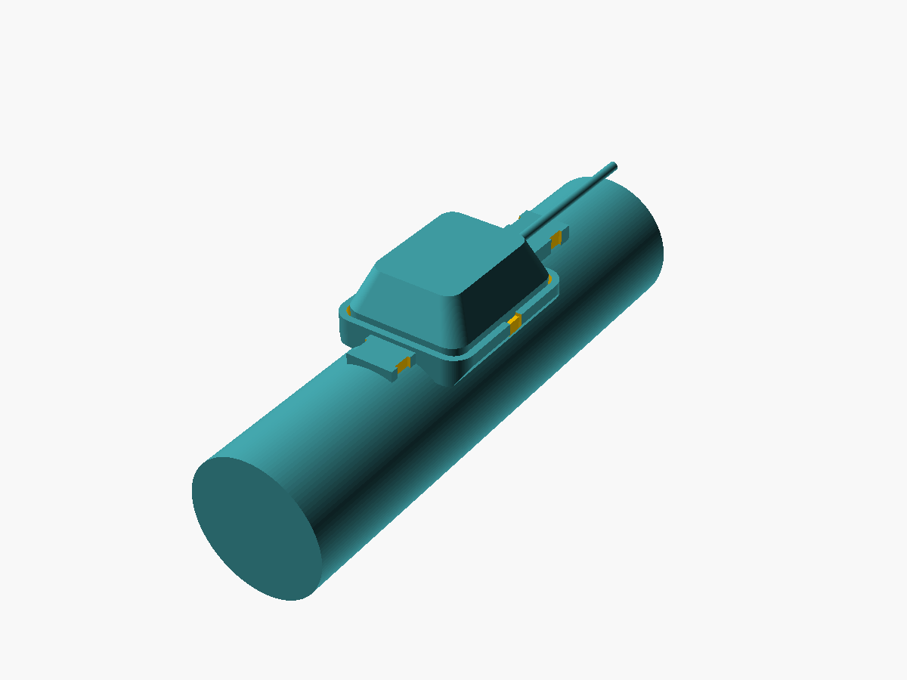

# GNSSアンテナ（JCA002）のロールバー用マウント



ロガーのGNSSアンテナ **JCA002**（秋月112223）を、ロールバーの上へ**結束バンドで**留めるための3Dプリント部品。
ケーブルは**ロールバーに沿う向き**に出る。

| ファイル | 中身 |
|---|---|
| `gnss_rollbar_mount.scad` | 本体（OpenSCAD。寸法はすべて先頭の変数で変えられる） |
| `gnss_rollbar_mount_d40.stl` | ロールバー φ40mm 用に書き出したもの |
| `preview.png` | アンテナとロールバーを重ねた図 |

## 考え方：アンテナの底のテープをロールバーに直接当てる

- JCA002の底には**最初から両面テープ（フォーム、厚さ約1mm）**が付いている（メーカーの取り付け方法も接着）。これを**ロールバーの頂上に線で当てて**、位置決めと回り止めに使う。別のテープは要らない
- ポケットの底は、ロールバーの頂上より**0.2mm低い平面**（`ant_tape_crush`＝圧着代）。真ん中に幅約15mmの窓があり、ロールバーの頂上が0.2mm出ている
- アンテナを押し込むと、テープは**ポケットの底の左右**に貼り付き、**真ん中の線でロールバーに0.2mm押し付けられる**
- アンテナの底面はロールバーの頂上から**約0.8mm**（テープ1.0mm − 圧着代0.2mm）。前の形（4.0mm）よりずっと近い
- アンテナの下にはバンドを通さない（通すとテープとロールバーの間に挟まるため）

## 形

- 外形 40.6 × 82.0 × 高さ8.0mm（φ40のとき）。ロールバーを抱える鞍形は頂上から片側40°。ポケットの深さ3.5mm
- 上から見た角は、ポケットの内側（R4）と本体の外側（R6＝R4＋壁厚2）を**同じ中心の円弧**にしている。タブ・舌の先はR3
- 結束バンドは**2本**＋おすすめの1本
  1. -Y側（ケーブルの出ない側）の**タブ**の上からかける1本
  2. +Y側の**舌**で**ケーブルの上から**かける1本：マウントとケーブルを一緒にロールバーへ押さえる（ケーブルの根元を揺らさない）
  3. （おすすめ）**アンテナの上から**回す1本：側壁の中央に溝がある（`top_tie_notch`）。テープをロールバーへ押し付け続ける役目。ナイロンのバンドなので受信への影響はほぼ無い
- 水はポケットの底の窓からロールバーに沿って抜ける

## 変える値

`.scad`の先頭の変数を変えて書き出し直す。

```
openscad -o gnss_rollbar_mount_d38.stl -D bar_d=38 gnss_rollbar_mount.scad
```

OpenSCADの画面で開けば、右の「カスタマイザー」から日本語の項目名で数値を変えられる。

| 変数 | 初期値 | 意味 |
|---|---|---|
| `bar_d` | 40 | ロールバーの外径。鞍・窓・抱え込みの形はすべてここから決まる |
| `wrap_deg` | 40 | 抱え込む角度（頂上から片側）。大きくするとしっかりするが厚くなる |
| `ant_tape_t` | 1.0 | アンテナの底に最初から付いている両面テープの厚さ。**要実測** |
| `ant_tape_crush` | 0.2 | 圧着代：ロールバーの頂上がポケットの底より出る量。**暫定** |
| `pocket_depth` | 3.5 | ポケットの深さ |
| `ant_corner_r` | 4 | ポケットの角R。外側の角Rはこれ＋壁厚 |
| `tie_w` | 4.8 | 結束バンドの幅 |
| `grommet_w` / `grommet_l` | 7.0 / 3.0 | アンテナのケーブル口（ブッシュ）の幅と出っ張り。**要実測** |
| `cable_h` | 2.5 | アンテナの底面からケーブル中心までの高さ。**要実測** |

φ25・φ50.8でも形が破綻しないことは確かめた（書き出しのみ。実物での確認はまだ）。

## 印刷

- **-Y側のタブの先を下にして立てて**印刷する。鞍の円弧が押し出し方向に並ぶのでサポートは基本不要
- 材料は**ASAかPETG**。車外で日に当たるので**PLAは使わない**（夏に柔らかくなる）
- 壁4周以上・充填40%以上を目安に

## 取り付け

1. ロールバーの頂上と、ポケットの底をアルコールで脱脂する（底は立てて印刷するので積層の筋が付く。筋が強ければ軽くやすりをかける）
2. マウントをロールバーの**水平な部分の上**に載せ、タブと舌の2本を仮に軽く締める（アンテナの上面が空を向くこと。斜めの部分だと傾く）
3. アンテナの底のはく離紙をはがし、ケーブルを+Y側の切り欠きに合わせて上から落とし込み、強く押さえる。貼り直しは効かないので、位置はポケットの壁に任せる
4. タブと舌の2本を本締めし、アンテナの上から1本回して締める。その先のケーブルもロールバーに沿わせて数か所留める
5. 手でひねって回らないか確かめる

## まだ確かめていないこと

- アンテナの底のテープの厚さ（`ant_tape_t`、1mm前後の記憶）と、テープが底一面に貼られているか。一部だけなら、真ん中（ロールバーの線）に当たる位置かを見る
- ブッシュの寸法（`grommet_w`・`grommet_l`・`cable_h`）は図からの見込み
- 圧着代0.2mmが適当か（押さえたときにテープが底の左右にも付くか、ロールバーの線で効いているか）
- 試し刷り・実車への取り付けは未実施
