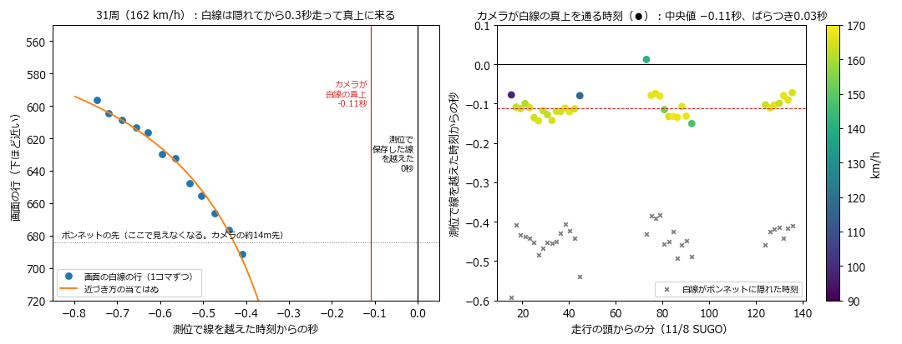

# 動画と測位の時刻の合い方（SUGO 11/8、2026-11-16）

解析アプリで線をチェッカーラインへ置き直したとき、「動画では20mくらい手前でチェッカーを越えて見える」と言われたので測った。

## 測り方

- 線：解析アプリでユーザーが航空写真のチェッカーラインに置いた線（`~/.ecologger-analysis/lines.json` の「コース上チェッカーライン」）
- 走行：SUGO 11/8 の決勝の日（`drive_logs/sessions/sugo_20261108_all.ecorun` の測位、動画は `drive_logs/v2_video/20261108_101115/` の焼き込み録画）。測位で線を越えた39回のうち34回（50 km/h以下の4回＝パレードの1回とピットロードを通った3回、白線の筋を取り違えた1回は除いた）
- 動画は、録画の横の `.csv`（コマの秒と測位の時刻）でコマを測位の時刻へ直した。コマの秒は ffmpeg のコマごとの時刻（pts）で取った（頭出しの直後にキーフレームまでのコマが同じ絵で埋まるので、コマの数から時刻を出すとずれる）
- 横切る白線が画面の下へ近づく動きを1コマずつ追い、平らな道のカメラの式（画面の行 = 地平線の行 + 定数 ÷ 前の距離、前の距離 = 速さ ×（真上を通る時刻 − 時刻））を、34回まとめて当てはめた。地平線の行と定数は全部の周で共通、真上を通る時刻は周ごと。当てはめの残りは平均4画素

## 分かったこと

- **白線は、画面でボンネットの先に隠れる時点で、まだカメラの約14m先にある。** 時速165 kmでは、隠れてから真上に来るまで約0.3秒（14m）走る
- **カメラが白線の真上を通るのは、測位で線を越えた時刻の 0.11秒前（140 km/h以上の32回の中央値、ばらつき0.03秒）**。時速165 kmで約5m。99・117 km/hの2回は0.08秒前
- 2時間の録画の頭から終わりまで、1回（+0.01秒）を除いて0.07〜0.15秒前の内に収まっている（録画の時刻の付け直しが走りながらずれていくことは無い）
- 「20mくらい手前」に見えたのは、ほとんどがボンネットで道が隠れる分（約14m）。残りの約5m（0.1秒）は、動画の時刻の進み・線の置き方（航空写真の上で数m）・アンテナとカメラの前後の差が混ざっていて、この測りでは分けられない

## 決めたこと

- 動画と測位の対応表は直さない（0.1秒は線の置き方の誤差と分けられず、焼き込み録画の時刻の付け方を変える理由にならない）
- 解析アプリの動画の位置は、線を切り直すとその場で新しい周の頭に合わせ直している（作りの上で更新のボタンは要らない）。切り直したときの知らせに、そのことを書き足した
- 動画で線を確かめるときは、白線がボンネットに隠れた所でなく、そこから約14m先（時速165 kmで0.3秒あと）が線の上

